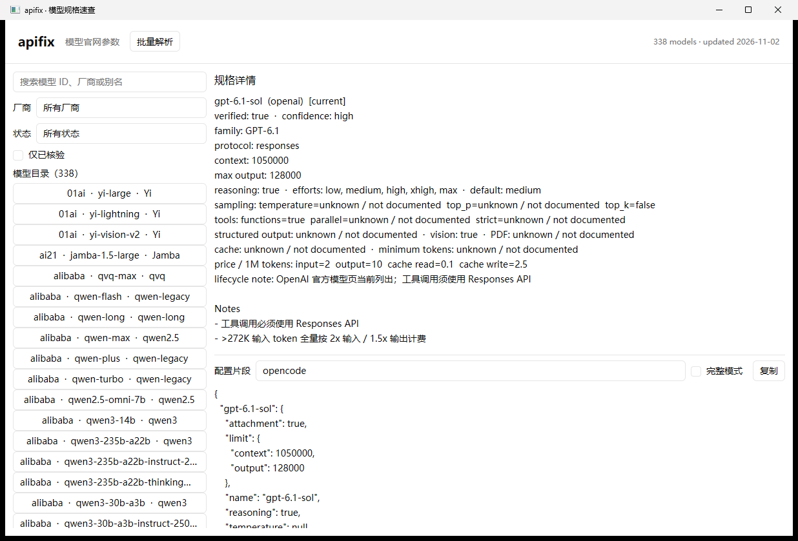
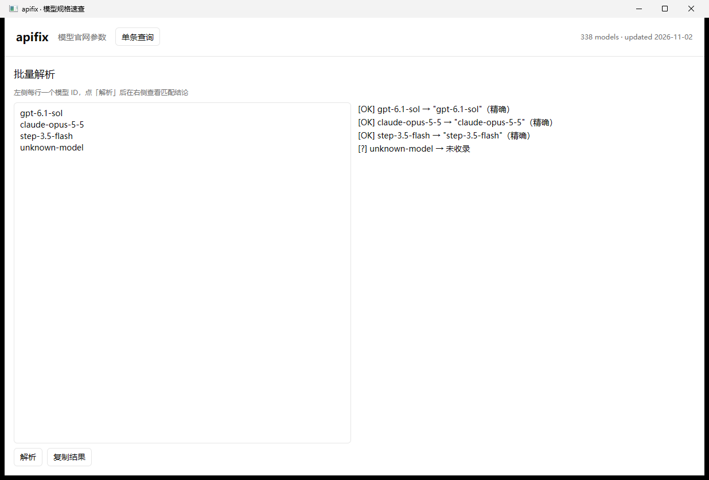

# apifix

[中文](README.md) | [English](README.en.md)


apifix is a Rust + GPUI desktop app: `cargo run` opens the native UI, and the CLI supports model lookup, listing, batch matching, comparison, config snippet generation, and config audit. Fully local, zero network requests.

## Why you need this

- **Relays keep official IDs but pair them with wrong numbers.** The official ID itself is stable, yet relays
  fill in context / max output themselves, those values drift as upstream changes, and nobody ever re-checks
  that one line in the client.
- **The numbers in your config are usually wrong or stale.** Relays fill in context / max output themselves,
  those values drift as upstream changes, and nobody ever re-checks that one line in the client.
- **"Dumbing down" happens silently.** In thinking mode, `temperature` is simply ignored, `top_p` has a floor,
  and unsupported effort levels quietly collapse into other levels. Behavior changed — your config won't tell you.
- **Switching models means reading 24 vendors' docs.** Every vendor draws the lines differently for reasoning
  levels, sampling constraints, caching, and tool calling.
- **apifix does one thing**: lay out the official spec and generate a snippet. Undocumented values are `null`.
  It never guesses.

## A real example

A relay config for `gpt-6-astra`, against the official spec:

| Field | Your config | Official spec |
| --- | --- | --- |
| context | 1,000,000 | 1,050,000 |
| max output | 200,000 | 128,000 |
| effort levels | low/high/max | low/medium/high/xhigh/max |
| temperature | true | not customizable |

Four fields, four discrepancies. Relay-filled numbers drift with upstream: max output is inflated one and a
half times, and the **effort list is missing `medium` and `xhigh`** — under this config you can never reach
the official middle reasoning tiers.

Now the "dumbing down" angle: OpenAI **does not support custom** `temperature`/`top_p` for `gpt-6-astra` at
all (values are ignored), tool calling requires the Responses API (Chat Completions doesn't support tools),
and **input above 272K tokens is billed entirely at 2x input / 1.5x output** — a long-context bill doubles
overnight. All of this surfaces in apifix's gotchas and in the generated snippets.

## Quick start

Install Rust 1.99+ (gpui-kit needs it; `rust-toolchain.toml` pins it), then install the Rust + GPUI version from GitHub:

```bash
cargo install --git https://github.com/xlong-c/apifix --locked
apifix                                  # GPUI desktop app
apifix gpt-6.1-sol                      # Rust CLI
```

Or clone and run from source:

```bash
git clone https://github.com/xlong-c/apifix && cd apifix
cargo run                              # native Rust + GPUI desktop app
cargo run -- gpt-6-astra               # CLI lookup and opencode snippet
cargo run -- audit ~/.config/opencode/opencode.json   # config audit (redacted)
```

`npm start` is equivalent to `cargo run` (use `cargo run -- ...` for everything else).

Common commands:

```bash
cargo run -- <id>                      # opencode snippet; stdout is pure JSON, notes go to stderr
cargo run -- <id> --emit pi            # pi snippet; also codex|claude-env|curl|sdk
cargo run -- <id> --emit codex -f      # full codex config.toml (provider block + placeholders)
cargo run -- <id> -f                   # full mode: adds family/status/modalities/cost, etc.
cargo run -- <id> --card               # spec card: full spec table + gotchas + sources
cargo run -- <id> --json               # raw catalog entry (every field)
cargo run -- <id> --name "GPT-6 Astra" # override the display name in the snippet
cargo run -- <id> --canonical-id       # key uses the canonical ID (e.g. gpt-6-astra-free → gpt-6-astra)
cargo run -- --list                    # all IDs grouped by vendor; --list --json for scripts
cargo run -- --match ids.txt           # batch-match a file, one verdict per line
cargo run -- search qwen               # full-text search
cargo run -- compare <id-a> <id-b>     # side-by-side comparison
cargo run -- audit <file>              # config audit (credentials redacted)
cargo run -- --version | --help
```

Exit codes: `0` success, `1` unmatched (for `audit`: differences found), `2` usage or file error.

### Config audit (`audit`)

Compares the spec written in your config against the catalog's official spec field by field and reports
`match` / `diff` / `unknown`:

```bash
cargo run -- audit ~/.config/opencode/opencode.json
cargo run -- audit ~/.pi/agent/models.json --json
cargo run -- audit ~/.codex/config.toml            # auto-detects TOML by suffix
cargo run -- audit ./my-config.json --format generic
```

`--format {auto,opencode,pi,codex,claude,generic}` (default auto) detects by suffix and content
(`.toml` → codex, an `env` block → claude). Output is always **credential-redacted**
(key/token/secret → `[REDACTED]`); the command only reads the file, never writes, never goes online.

> **Config repair** (`fix`), the interactive **add-a-provider** wizard (`login`), and **protocol scanning**
> (`protocols`) are **not available yet**: they were removed with the legacy Node CLI and still need a
> Rust port.

## Desktop UI (GPUI)

```bash
cargo run
# or npm start
```

Single-model lookup and specification details:



Batch matching:



The legacy browser UI and Node CLI have been removed; the desktop app is the only GUI entry point.

> **GPU requirement**: GPUI is a GPU-rendered framework with no software-rendering fallback. When no usable GPU is present (no graphics card, VM, remote desktop without GPU passthrough, Linux without a Vulkan driver, …) the window fails to open; the program prints a hint and exits with code 1. Use the CLI (`cargo run -- <model-id>`) instead.

## Coverage

338 entries across 24 vendors:

| vendor | count | vendor | count | vendor | count |
| --- | ---: | --- | ---: | --- | ---: |
| openai | 65 | anthropic | 27 | alibaba | 42 |
| zhipu | 22 | moonshot | 22 | baidu | 17 |
| google | 17 | cohere | 15 | mistral | 12 |
| tencent | 11 | volcengine | 11 | deepseek | 10 |
| nvidia | 8 | amazon | 7 | iflytek | 7 |
| microsoft | 7 | meta | 7 | xai | 16 |
| minimax | 5 | 01ai | 3 | stepfun | 4 |
| unisound / ai21 / writer | 1 each | | | |

Lifecycle: `current` 161, `legacy` 92, `retired` 82, `unreleased` 2 (plus 1 unlabeled). 318 entries are verified against official docs.

**Pricing**: 239 models carry official USD pricing (per 1M tokens). Non-USD prices are converted at merge time
using a fixed reference rate of 1 USD = 7.2 CNY, with the original values kept in `cost.note`. That rate is a
reference, not a live quote.

## Matching rules

**Two contexts, with different strictness:**

- **Config recognition** (`audit` reading a model id from a config file):
  **only id / aliases / legacy ids count** — the chain is `id → model → interface → params`. Normalized
  forms (`glm-5.3-flash-free`, `stepfun/step-5-preview`) get a "closest match" suggestion only and never
  inherit the official spec automatically (a relay variant may be a different model). Relay-invented
  names (e.g. `MiniMaxAI/MiniMax-M2`) are **registered explicitly as `aliases`** — the anchor is a
  curated fact, not a guess.
- **Direct lookups** (`apifix <id>` / `--match` / the desktop UI): after id / alias / legacy it tries
  stripping the vendor prefix (`openai/`, `anthropic/`, `meta/`, `google/`, `z-ai/`, `stepfun/`, and more —
  a static alias list plus **every vendor from the catalog is added automatically**), stripping relay
  suffixes (`-free`, `-preview`, `-exp`, `-latest`, `-build`, `-contributor`, `-vision-exp`,
  `-expires-on-*`, `-ga-*`, `-YYYYMMDD`, `-vN`), separator-insensitivity (`-`, `.`, `_` are equivalent),
  a fuzzy fallback (≥ 0.75, suggestion only), and a short-shorthand prefix suggestion (`step5` →
  `step-5-preview (prefix match)`, also suggestion-only).

`--match` labels: `[OK]` exact, `[A]` alias, `[L]` legacy, `[~]` normalized, `[?]` unmatched.
Notes go to **stderr** only, so stdout stays paste-ready:

```
[i] gpt-6-astra-free -> 官网规范 id gpt-6-astra（值采用官方规格，去除 relay 后缀 -free）
```

Note: `-free` is a **third-party / relay convention** (OpenCode Zen, AIHubMix, and others; OpenRouter uses the
colon form `:free`). It is **not** a vendor naming convention — official low-cost tiers get their own model names
(such as `gpt-5.4-mini`, `gpt-5.4-nano`).

## Full mode (`-f`)

By default only 7 core fields are emitted. `-f` adds every derivable field the catalog can supply: `opencode`
gains `family`, `status` (`current`→active / `legacy`/`retired`→deprecated / `unreleased`→beta), `modalities`
(input derived from `vision`/`pdf`), and `cost` (when official pricing exists); `pi` gains `api`
(`anthropic_messages`→anthropic-messages, `responses`→openai-responses, `chat_completions`→openai-completions;
`native`/`gemini`/null are omitted).

`cost` is always **USD per 1M tokens** (`input`/`output`/`cache_read`/`cache_write`/`context_over_200k`, with
null keys omitted; if either `input` or `output` is missing, `cost` is omitted entirely). Fields the catalog has
no official data for (opencode's release_date/interleaved/experimental/options/headers, pi's
provider/baseUrl/compat/cost) are **omitted**, with a single `[i]` note on stderr — that note is dynamic, so
`cost` drops out of the list once it is emitted.

`-f` applies to `--emit opencode|pi|codex|claude-env` (curl/sdk print a notice and ignore it):
opencode/pi add the full field set; codex prints a complete `config.toml`
(`model_provider` + a `[model_providers.x]` block); claude-env prints the `env` block of
`~/.claude/settings.json` (all values are strings). `base_url` / `env_key` /
`ANTHROPIC_AUTH_TOKEN` are always **placeholders** (no network, nothing invented) — replace them before
use. `--card`/`--json`/`--list`/`--match` already show complete data.

```bash
cargo run -- gpt-6-astra -f                    # full opencode mode (with cost)
cargo run -- gpt-6-astra --emit pi -f          # full pi mode
cargo run -- gpt-6-astra --emit codex -f       # full codex config.toml (with provider block)
cargo run -- gpt-6-astra --emit claude-env -f  # env block for ~/.claude/settings.json
```

## Data provenance and trust

- **Only vendor-official docs** (model pages, API docs, pricing pages). Aggregators, relay dashboards, and
  forums are not sources.
- **`null` means "not documented"**, not zero; it renders as `未知/not documented`. Better empty than invented.
- **`verified`**: `true` means every field was checked against official docs (318/338); `false` means the source
  is indirect or pending, and the card says so explicitly.
- **`confidence`** (`high`/`medium`/`low`) works together with `sources`, so every value is traceable.
- Lifecycle and `legacy_ids` record retirements and relay-reused IDs; **retired models show their pre-retirement spec**.

Known limitations: the catalog is a static snapshot and does not auto-update; fuzzy matching only suggests, it
never auto-corrects; `ark-code-latest` is a routing alias whose real spec depends on the console selection; keys
in `curl`/`sdk` snippets need environment variables you set yourself.

## Project layout

```
apifix/
├── Cargo.toml        Rust CLI + GPUI desktop app
├── rust-toolchain.toml  Pins Rust 1.99 (required by gpui-kit)
├── src/              Rust catalog, matching, rendering, audit, and catalog-tooling modules
├── src/gui.rs        GPUI desktop interface (single lookup + batch parsing)
├── src/catalog_tools.rs  catalog/ ↔ catalog.json build + validation
├── catalog/          Source of truth: one file per vendor (catalog/<vendor>.json, edit these)
├── catalog.json      **Generated** bundle built from catalog/ (do not hand-edit)
├── tools/            Incoming-batch merge script only (merge-catalog.mjs, Node)
├── incoming/         Raw research batches (traceable provenance)
└── skills/           Companion AI skills (model-spec-lookup / catalog-maintain)
```

To change data: edit `catalog/<vendor>.json` → run `cargo run -- catalog build` to regenerate `catalog.json`
(see [CONTRIBUTING.md](CONTRIBUTING.md)).

## FAQ

**Where does the data come from?**
Entirely from vendor-official docs, each entry carrying `sources` links. The raw research batches live in
`incoming/` for traceability.

**Why is my ID unmatched?**
It may be neither an official ID nor a known alias or legacy ID (relay-invented names, for example). Run
`--match` over a file: unmatched lines get the closest candidate. If it's a real model, add it per
[CONTRIBUTING.md](CONTRIBUTING.md).

**Is the pricing accurate?**
Prices come from official pricing pages, are stamped with `as_of`, and carry a `confidence` rating. They are a
**static snapshot**, not real-time; for frequently repriced models, trust your vendor invoice. Non-USD prices are
converted at a 1 USD = 7.2 CNY reference rate, with originals preserved in `cost.note`.

**Does it read or upload my config?**
Locally only, and never over the network: `audit` reads the config file you point it at. Credential fields
are stripped at extraction time and never echoed in any output. The project makes no network requests at all.

**How does it relate to cc-switch?**
It doesn't — no dependency either way. The generated snippets paste straight into your relay config, so the two
can be used together.

**How do I add or fix a model?**
See [CONTRIBUTING.md](CONTRIBUTING.md): drop research into `incoming/`, run `npm run merge`, then
`cargo run -- catalog validate` (CI runs it on every push/PR).

## Contributing

New models and corrections to stale specs are welcome. Start with [CONTRIBUTING.md](CONTRIBUTING.md) — the one
rule that matters most: **cite only official docs, and write `null` for anything undocumented.**

## License

[MIT](LICENSE)