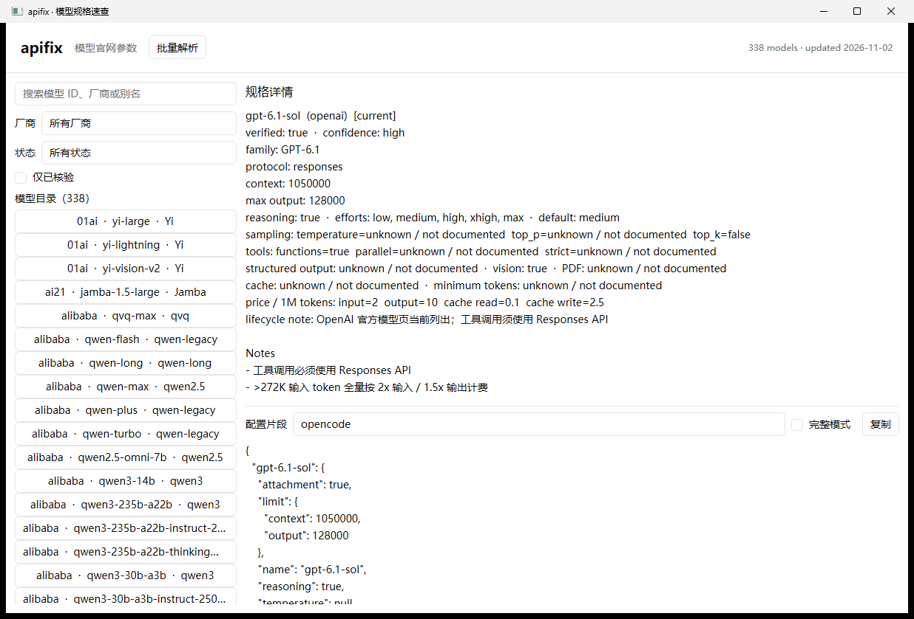
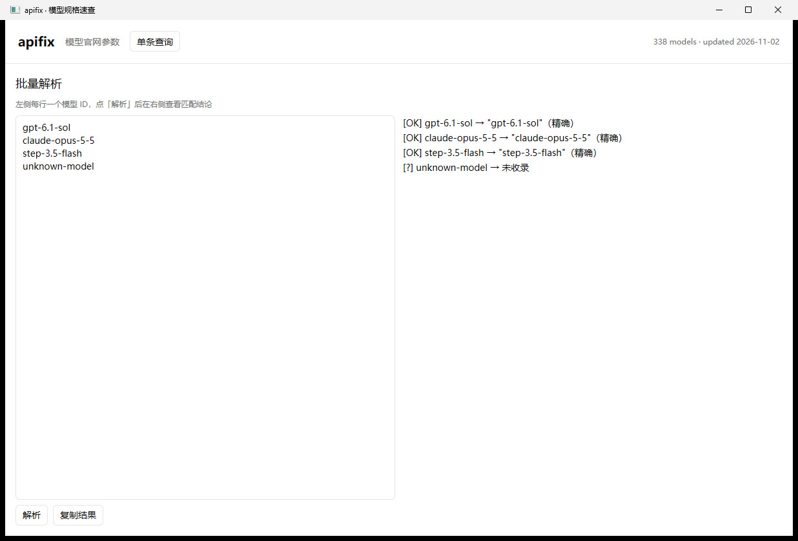

# apifix

[中文](README.md) | [English](README.en.md)


apifix 是 Rust + GPUI 桌面应用：`cargo run` 启动原生界面，CLI 支持模型查询、列表、批量匹配、比较、配置片段生成与配置审计。纯本地、零网络请求。

## 为什么需要它

- **中转沿用官方 id，却配上错数字。** 官方 id 是稳定的，但中转自己填的 context / max output 会随上游漂移，客户端里那一行没人会去核对。
- **你配置里的数字往往是错的或过期的。** 中转自己填的 context / max output 会随上游漂移，客户端里那一行没人会去核对。
- **"降智"是静默发生的。** thinking 模式下 `temperature` 被直接忽略、`top_p` 有下限、官方不支持的 effort 档位悄悄回落到别的档位。行为变了，但你从配置上看不出来。
- **换模型等于读 23 家厂商的文档。** 每家对推理档位、采样约束、缓存、工具调用的口径都不一样。
- **apifix 只做一件事**：把官方规格摊开，顺手生成配置片段。它对未文档化的值写 `null`，绝不猜。

## 一个真实例子

中转配置里的 `gpt-6-astra`，对比官网规格：

| 字段 | 你的配置 | 官网规格 |
| --- | --- | --- |
| context | 1,000,000 | 1,050,000 |
| max output | 200,000 | 128,000 |
| effort 档位 | low/high/max | low/medium/high/xhigh/max |
| temperature | true | 不支持自定义 |

四个字段，四处偏差。中转自己填的数字随上游漂移：max output 夸大一倍半，
**effort 档位少了 `medium` 和 `xhigh`**——这份配置下你永远用不到官方的两档中间推理强度。

再看"降智"那一面：OpenAI 对 `gpt-6-astra` **完全不支持自定义** `temperature`/`top_p`
（传了也不生效），工具调用必须走 Responses API（Chat Completions 不支持 tools），
**>272K 输入 token 全量按 2x 输入 / 1.5x 输出计费**——长上下文账单一夜翻倍。
这些都是 apifix 卡片和片段里的「注意事项」。

## 快速开始

安装 Rust 1.99+（gpui-kit 依赖的 gpui-pre 需要该版本；仓库内的 `rust-toolchain.toml` 已固定），从 GitHub 安装 Rust + GPUI 版本：

```bash
cargo install --git https://github.com/xlong-c/apifix --locked
apifix                                  # GPUI 桌面应用
apifix gpt-6.1-sol                      # Rust CLI
```

### 从源码运行

```bash
git clone https://github.com/xlong-c/apifix && cd apifix
cargo run                              # GPUI 原生桌面 UI
cargo run -- gpt-6-astra               # CLI 查询并生成 opencode 片段
cargo run -- audit ~/.config/opencode/opencode.json   # 配置审计（已脱敏）
```

`npm start` 等价于 `cargo run`（其余 `cargo run -- ...` 命令直接用 cargo 即可）。

常用命令：

```bash
cargo run -- <id>                      # opencode 片段；stdout 是纯 JSON，提示走 stderr
cargo run -- <id> --emit pi            # pi 片段；也可 codex|claude-env|curl|sdk
cargo run -- <id> --emit codex -f      # 完整 codex config.toml（provider 段 + 占位符）
cargo run -- <id> -f                   # 完整模式：追加 family/status/modalities/cost 等
cargo run -- <id> --card               # 规格卡片：完整规格表 + 注意事项 + 来源
cargo run -- <id> --json               # catalog 原始条目（全部字段）
cargo run -- <id> --name "GPT-6 Astra" # 覆盖片段里的展示名
cargo run -- <id> --canonical-id       # key 用官网规范 id（如 gpt-6-astra-free → gpt-6-astra）
cargo run -- --list                    # 全部 id（按 vendor 分组）；--list --json 供脚本用
cargo run -- --match ids.txt           # 逐行批量匹配，逐行给结论
cargo run -- search qwen               # 全文搜索
cargo run -- compare <id-a> <id-b>     # 并排对比
cargo run -- audit <file>              # 配置审计（凭证脱敏）
cargo run -- --version | --help
```

退出码：`0` 成功、`1` 未收录（`audit` 为「发现差异」）、`2` 用法或文件错误。

### 配置审计（audit）

把配置里写下的规格和 catalog 的官网规格逐字段对比，报出 `match` / `diff` / `unknown`：

```bash
cargo run -- audit ~/.config/opencode/opencode.json
cargo run -- audit ~/.pi/agent/models.json --json
cargo run -- audit ~/.codex/config.toml            # auto 按后缀识别 TOML
cargo run -- audit ./my-config.json --format generic
```

`--format {auto,opencode,pi,codex,claude,generic}`（默认 auto）：按后缀与内容识别
（`.toml` → codex、含 `env` 块 → claude）。输出已强制**凭证脱敏**
（key/token/secret → `[REDACTED]`），本命令只读文件、不联网、不写入。

> 配置**修复**（`fix`）、交互式**添加供应商**（`login`）、**协议扫描**（`protocols`）目前
> **尚未提供**：随旧 Node CLI 一起移除，后续按同样语义往 Rust 移植。

## 桌面 UI（GPUI）

```bash
cargo run
# 或 npm start
```

单条查询与规格详情：



批量解析：



旧版浏览器 UI 与 Node CLI 已移除；桌面版就是唯一 GUI 入口。

> **GPU 要求**：GPUI 是 GPU 渲染框架，没有软件渲染降级。GPU 不可用（无显卡、虚拟机、
> 远程桌面未直通、Linux 缺 Vulkan 驱动等）时窗口创建失败，程序会打印提示并以退出码 1 结束，
> 此时请改用 CLI（`cargo run -- <model-id>`）。

## 支持范围

当前收录 **338** 个条目、24 个 vendor：

| vendor | 数量 | vendor | 数量 | vendor | 数量 |
| --- | ---: | --- | ---: | --- | ---: |
| openai | 65 | anthropic | 27 | alibaba | 42 |
| zhipu | 22 | moonshot | 22 | baidu | 17 |
| google | 17 | cohere | 15 | mistral | 12 |
| tencent | 11 | volcengine | 11 | deepseek | 10 |
| nvidia | 8 | amazon | 7 | iflytek | 7 |
| microsoft | 7 | meta | 7 | xai | 16 |
| minimax | 5 | 01ai | 3 | stepfun | 4 |
| unisound / ai21 / writer | 各 1 | | | |

生命周期：`current` 161、`legacy` 92、`retired` 82、`unreleased` 2（另有 1 条未标注）；318 条已核验官网。

**定价**：**239** 个模型带官方 USD 定价（每 1M tokens）。非美元定价在合并时按固定参考汇率
1 USD = 7.2 CNY 换算，原始币种数值保留在 `cost.note` 里；该汇率是参考值，不是实时行情。

## 匹配规则

**分两种场景，严格程度不同：**

- **配置识别**（`audit` 读取配置里的模型 id）：**只认 id / 别名 / legacy**——
  链路是 `id → 模型 → 识别接口 → 修复参数`。归一化写法（`glm-5.3-flash-free`、`stepfun/step-5-preview`）
  只给「最接近」建议，**不会自动套用官网规格**（中转变体可能是另一个型号，宁可让人确认）。
  中转自造的名字（如 `MiniMaxAI/MiniMax-M2`）在 catalog 里**显式登记为 `aliases`** 做锚定——
  锚点是登记的事实，不靠算法猜。
- **直接查询**（`apifix <id>` / `--match` / 桌面 UI）：在 id / 别名 / legacy 之外，依次尝试
  去厂商前缀（`openai/`、`anthropic/`、`meta/`、`google/`、`z-ai/`、`stepfun/` 等——静态别名表 +
  **目录内 vendor 自动并入**，新增厂商无需改代码）→ 去 relay 后缀（`-free`、`-preview`、`-exp`、
  `-latest`、`-build`、`-contributor`、`-vision-exp`、`-expires-on-*`、`-ga-*`、`-YYYYMMDD`、`-vN`）→
  分隔符等价（`-` `.` `_` 视为相同，故 `gpt_6_astra` 命中 `gpt-6-astra`）→ 模糊兜底（相似度 ≥ 0.75，
  只给建议）→ 短缩写前缀建议（如 `step5` → `step-5-preview（前缀匹配）`，同样只给建议、不自动纠错）。

`--match` 标签：`[OK]` 精确、`[A]` 别名、`[L]` legacy、`[~]` 归一化、`[?]` 未收录。
提示只写到 **stderr**，不污染 stdout 的可粘贴输出：

```
[i] gpt-6-astra-free -> 官网规范 id gpt-6-astra（值采用官方规格，去除 relay 后缀 -free）
```

注意：`-free` 是**第三方/中转约定**（OpenCode Zen、AIHubMix 等；OpenRouter 用冒号形式 `:free`），
**不是厂商官方命名**——官方低价档会用独立模型名（如 `gpt-5.4-mini`、`gpt-5.4-nano`）。

## 完整模式（`-f`）

默认只输出 7 个核心字段；`-f` 追加 catalog 能提供的全部可推导字段：`opencode` 增加 `family`、`status`
（`current`→active / `legacy`/`retired`→deprecated / `unreleased`→beta）、`modalities`（按 `vision`/`pdf`
推导 input）、`cost`（有官方定价时）；`pi` 增加 `api`（`anthropic_messages`→anthropic-messages、
`responses`→openai-responses、`chat_completions`→openai-completions；`native`/`gemini`/null 则省略）。

`cost` 一律是**美元 / 每 1M tokens**（`input`/`output`/`cache_read`/`cache_write`/`context_over_200k`，
空值键省略；`input`/`output` 缺一即整体不输出）。catalog 里没有官方数据的字段（opencode 的
release_date/interleaved/experimental/options/headers，pi 的 provider/baseUrl/compat/cost）**一律省略**，
并在 stderr 用一条 `[i]` 说明——该说明是动态的，`cost` 成功输出后会从缺失列表里去掉。

`-f` 对 `--emit opencode|pi|codex|claude-env` 生效（curl/sdk 会提示忽略）：opencode/pi 追加完整字段；
codex 输出完整 `config.toml`（`model_provider` + `[model_providers.x]` 段）；claude-env 输出
`~/.claude/settings.json` 的 `env` 块（值均为字符串）。其中 `base_url` / `env_key` /
`ANTHROPIC_AUTH_TOKEN` 一律是**占位符**（不联网、不臆造），替换后再用；
`--card`/`--json`/`--list`/`--match` 本就展示完整数据。

```bash
cargo run -- gpt-6-astra -f                    # opencode 完整模式（含 cost）
cargo run -- gpt-6-astra --emit pi -f          # pi 完整模式
cargo run -- gpt-6-astra --emit codex -f       # 完整 codex config.toml（含 provider 段）
cargo run -- gpt-6-astra --emit claude-env -f  # ~/.claude/settings.json 的 env 块
```

## 数据来源与可信度

- **只采信厂商官方文档**（官方模型页 / API 文档 / 定价页）。聚合站、中转商后台、论坛不作为来源。
- **`null` = 官方未文档化**，不是「等于 0」；渲染为 `未知/not documented`。宁可留空，绝不臆造数值。
- **`verified`**：`true` 表示已与官方文档逐项核验（318/338）；`false` 表示来源间接或待核验，卡片会显式提示。
- **`confidence`**（`high`/`medium`/`low`）配合 `sources` 使用，来源可逐条追溯。
- 生命周期与 `legacy_ids` 记录退役、中转沿用 id 的历史；**退役模型的规格为退役前规格**。

已知限制：目录是静态快照，不会自动更新；模糊匹配只给建议、不自动纠错；`ark-code-latest` 是路由别名，
真实规格随控制台选择变化；`curl`/`sdk` 片段里的 key 需自行设置环境变量。

## 项目结构

```
apifix/
├── Cargo.toml        Rust CLI + GPUI 桌面应用
├── rust-toolchain.toml  固定 Rust 1.99（gpui-kit 所需）
├── src/gui.rs        GPUI 桌面界面（单条查询 + 批量解析）
├── src/              Rust 目录、匹配、渲染与 UI 模块
├── src/catalog_tools.rs  catalog/ ↔ catalog.json 构建与校验（取代旧 Node 脚本）
├── catalog/          数据源：一厂商一文件（catalog/<vendor>.json，手工编辑这里）
├── catalog.json      **生成物**：由 catalog/ 打包的 bundle（勿手工编辑）
├── tools/            仅剩 incoming 批次合并脚本（merge-catalog.mjs，Node）
├── incoming/         原始调研批次（可追溯数据来源）
└── skills/           配套 AI 技能（model-spec-lookup / catalog-maintain）
```

改数据：编辑 `catalog/<vendor>.json` → `cargo run -- catalog build` 重建 `catalog.json`（详见
[CONTRIBUTING.md](CONTRIBUTING.md)）。

## 常见问题

**数据是哪里来的？**
全部来自厂商官方文档，逐条附 `sources` 链接。`incoming/` 里保留了原始调研批次，可回溯。

**为什么我的 id 显示未收录？**
它可能既不是官方 id、也不是已知的别名或 legacy id（比如中转自造的命名）。用 `--match` 批量跑一遍，
未收录时给出最接近的候选；确认是真实模型就按 [CONTRIBUTING.md](CONTRIBUTING.md) 补一条。

**价格准吗？**
价格来自官方定价页，标注 `as_of` 日期，并用 `confidence` 标注可信度。它是**静态快照**，不保证实时；
调价频繁的模型请以厂商账单为准。非美元定价按 1 USD = 7.2 CNY 参考汇率换算，原值保留在 `cost.note`。

**会读取或上传我的配置吗？**
只在本地读取：`audit` / `fix` 读取你指定的配置文件，`protocols` 默认扫描已知路径
（`--file` 可指定）。凭证字段在提取阶段即被剥离，任何输出都不回显；`fix` 写入前自动备份。
唯一发起网络请求的是 `login` 的模型自动检测，且只请求你自己填写的 baseURL。

**和 cc-switch 什么关系？**
无关，也不依赖它。生成的片段可以直接贴进你的中转配置，两者可以配合使用。

**怎么新增或修正一个模型？**
见 [CONTRIBUTING.md](CONTRIBUTING.md)：调研结果落到 `incoming/` 批次，跑 `npm run merge` 合并、
`cargo run -- catalog validate` 校验（CI 每次 push/PR 都会跑）。

## 参与贡献

欢迎补充新模型、修正过期规格。请先读 [CONTRIBUTING.md](CONTRIBUTING.md)——最重要的一条是：
**只引用官方文档，未文档化的值写 `null`。**

## License

[MIT](LICENSE)
